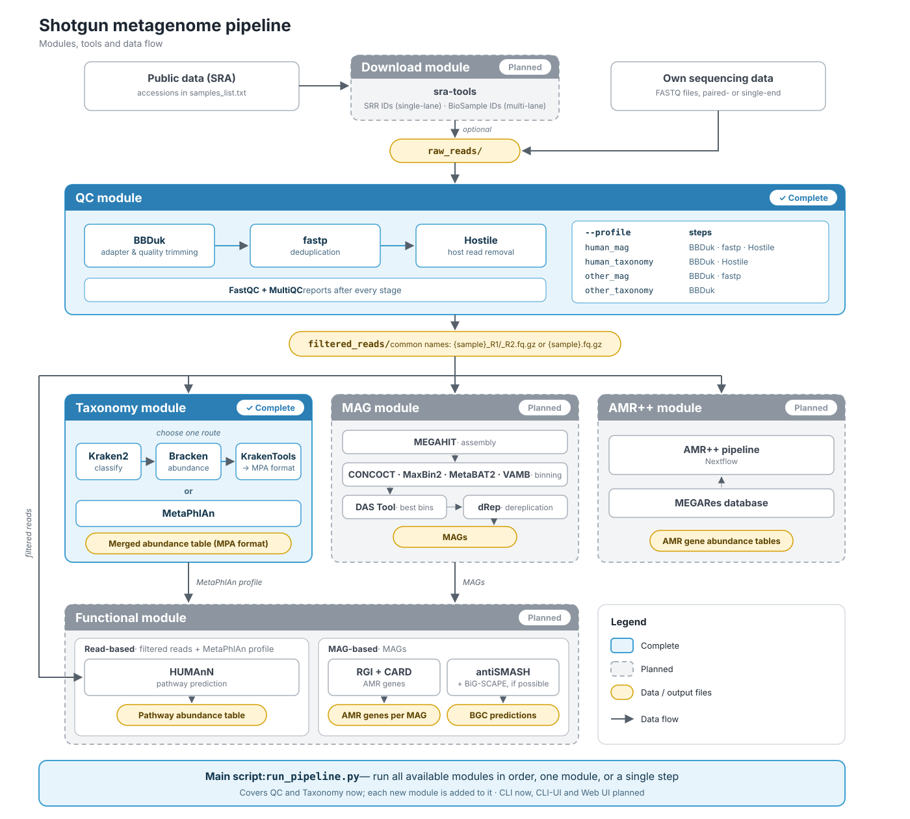

```{=html}
<style>#title-block-header { display: none; }</style>
```


A modular pipeline to analyze shotgun metagenome reads.

:::{.callout-important title="Under development"}
Code cleanup is underway, and adding documentation...  

QC module: Tested successfully on Illumina paired-end data  
Taxonomy module: Currently testing...

:::

## Pipeline

{.border}

## Quickstart

Requires...

- a list of studies (studies_list.txt) 
- a list of samples per study (samples_list.txt)
- a list of **installed** tools and databases (utility_paths.csv)
- compressed reads (`.gz` format) in raw_reads directory

...in the following structure

```bash
.
├── studies_list.txt
├── utility_paths.csv
├── Study1
│   ├── raw_reads
│   └── samples_list.txt
├── Study2
│   ├── raw_reads
│   └── samples_list.txt
└── Study3
    ├── raw_reads
    └── samples_list.txt
```

Run all the available modules in a predefined order.

```bash
python run_pipeline.py run all
```

This uses default values for all the options.

```bash
python run_pipeline.py run --help

usage: run_pipeline.py run [-h] [-b BASE_DIR] [-s SAMPLES] [-p PROJECTS] [-u UTILITY_PATHS] [-t THREADS] [-l [{1,2,3}]] [--resume] [-v] [--log_file LOG_FILE] [--profile {human_mag,human_taxonomy,other_mag,other_taxonomy}]
                           [--keep_intermediate] [--tool {kraken,metaphlan}] [-r READS_DIR] [--confidence CONFIDENCE]
                           MODULE [MODULE ...]

Run the selected modules in this order: qc -> taxonomy. Options of all modules are accepted.

positional arguments:
  MODULE                One or more of: qc, taxonomy, or all.

options:
  -h, --help            show this help message and exit
  -b, --base_dir BASE_DIR
                        Main directory with all the data. (Default: Current directory)
  -s, --samples SAMPLES
                        List of sample IDs as text file, just the file name, not its path. (Default: samples_list.txt)
  -p, --projects PROJECTS
                        List of project names as text file. (Default: studies_list.txt)
  -u, --utility_paths UTILITY_PATHS
                        Envs or Paths for tools and DBs as a CSV file. (Default: utility_paths.csv)
  -t, --threads THREADS
                        Number of threads (Default: 1)
  -l, --split_size [{1,2,3}]
                        Number of sub_lists to run concurrently (Default: 1, no splitting).
  --resume              Continue a previous run: skip finished samples, redo the rest. Without it, stop if results of a previous run exist.
  -v, --verbose         Show debug messages.
  --log_file LOG_FILE   Also write log messages to this file.
  --profile {human_mag,human_taxonomy,other_mag,other_taxonomy}
                        Sample type and goal. human_mag: BBDuk+fastp+Hostile; human_taxonomy: BBDuk+Hostile; other_mag: BBDuk+fastp; other_taxonomy: BBDuk only. (Default: human_mag)
  --keep_intermediate   Keep BBDuk/fastp reads after Hostile succeeded (default: delete them to save space).
  --tool {kraken,metaphlan}
                        kraken: Kraken2+Bracken; metaphlan: MetaPhlAn. (Default: metaphlan)
  -r, --reads_dir READS_DIR
                        Input directory name containing reads. (Default: filtered_reads)
  --confidence CONFIDENCE
                        Kraken2 confidence score threshold, from 0 to 1. (Default: 0.0)
```

:::{.callout-warning icon="false" title="`--reads_dir`" collapse="true"}
[Issue:]{.small} Default value of `-r` is being displayed from the Taxonomy module, but the actual default is the `raw_reads` directory. It is due to the reuse of `-r` option in multiple scripts (will be fixed). Pipeline is working as expected.
:::


Currently available modules and scripts...
```bash
python run_pipeline.py --help

usage: run_pipeline.py [-h] COMMAND ...

Main script: run several modules in order, one module, or a single step.

run_pipeline.py run all -b all_data -t 8            # every module, in MODULES order
run_pipeline.py run qc taxonomy --profile human_taxonomy --tool kraken
run_pipeline.py qc --profile other_mag              # one module
run_pipeline.py bbduk -b all_data                   # one step
run_pipeline.py COMMAND -h                          # options of a command

positional arguments:
  COMMAND
    run         Run modules in order: qc -> taxonomy (or 'all').
    qc          Perform QC on shotgun reads. Runs FastQC, MultiQC and BBDuk, plus fastp and Hostile depending on the profile.
    taxonomy    Taxonomy module: profile filtered reads with Kraken2+Bracken or MetaPhlAn and merge the profiles of all studies...
    qc_reports  Generate QC reports. Runs FastQC and MultiQC. Expects the name of the directory with reads, by default looks for raw_reads directory
    bbduk       Trimming SE or PE reads with BBDuk...
    fastp       Reduce duplicate reads from SE or PE reads with fastp
    hostile     Remove host reads from SE or PE short reads with Hostile
    kraken      Classify reads with Kraken2 and Bracken, convert to MPA format and merge the MPA files of all studies
    metaphlan   Profile read-files with MetaPhlAn (read-stats and relative-abundance profiles) and merge the profiles of all studies.

options:
  -h, --help    show this help message and exit
```


Check [**Run**]() page for more details